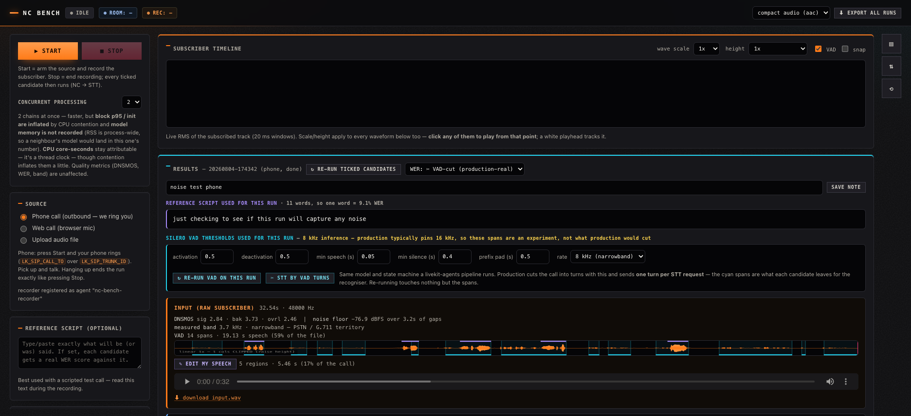

# NC Bench UI

A dev web UI for A/B-testing noise-cancellation candidates on real audio:
record a **phone call** (outbound — the bench places it), a **web call**
(browser mic), or **upload a file** — then run the recording through every ticked NC
candidate (singles or chains) and compare **STT transcripts**, **waveforms**,
and **playable / downloadable output audio** side by side. Every run is stored
and revisitable from the history table.



## Run

```bash
uv sync --python 3.12                        # once
.venv/bin/python scripts/fetch_models.py     # once; ~70 MB of model files
.venv/bin/python scripts/fetch_vads.py       # once; ~30 MB, the VAD bench's models
.venv/bin/python main.py                     # http://localhost:8777
```

**No model weights are stored in this repo.** `fetch_models.py` pulls every one
of them from its publisher's own URL into the gitignored `models/`, and checks a
pinned SHA-256 on each. `--verify` re-hashes what is already on disk. See
[Models and licences](#models-and-licences) for who owns what.

Two candidate families need credentials that are not supplied here. Both
degrade politely — the UI greys them out with a reason and everything else
still runs:

- **Hecttor** (`hecttor-*`) needs its proprietary SDK wheel, which is *not*
  redistributed here and is not on PyPI. With a valid licence:
  `uv pip install /path/to/hecttor_sdk-<version>-<platform>.whl`, then set
  `HECTTOR_API_KEY`.
- **ai-coustics standalone** (`aicsdk-*`) needs a self-service trial key in
  `AIC_LICENSE_KEY`. `fetch_models.py` fetches its models too, through the SDK's
  own downloader.

The **LiveKit Cloud** candidates (`krisp-*`, `lkaic-*`, `cloud-raw`) need
`LIVEKIT_URL` to be a `*.livekit.cloud` project with the API key and secret.

Configuration lives in `.env` (see `.env.example`): LiveKit project, STT
endpoint, Hecttor key + default model/weight/rate/chunk, port.

> `uv sync` prunes anything not in the lock, so it will uninstall a
> manually-installed Hecttor wheel. Re-run the `uv pip install` above after a
> sync.

## Using it

1. Pick a **source**:
   - **Phone call** — press Start and **the phone rings**. The bench places an
     outbound SIP call to `LK_SIP_CALL_TO` over `LK_SIP_TRUNK_ID` (both `.env`)
     into a room it owns. Pick up, talk, then either **hang up or press Stop** —
     both end the recording and run NC. See *Phone mode* below.
   - **Web call** — Start joins a fresh room and publishes the microphone with
     browser echo-cancellation / noise-suppression / AGC **disabled**, so the
     noise survives for the NC to act on.
   - **Upload** — any format ffmpeg can read; goes straight to processing.
2. Tick **candidates** (at least one; "No NC" is the control). Chains run
   processors in order — edit `candidates.json` to add combos or Hecttor
   model/weight variants; restart to reload.
3. **Start** → record (single subscriber timeline shows live RMS) → **Stop**.
   Both buttons gray out while the candidates run (NC → STT per candidate);
   results stream in as each finishes.
4. **History**: every run keeps `input.wav` + one output wav per candidate +
   `meta.json` under `data/runs/<id>/`; click a row to reload it.
   **Re-run ticked candidates** merges into the run by candidate id:
   - Records that aren't re-run stay exactly as they were.
   - A re-run record is replaced only when its new result succeeds; its output
     is staged in `.attempt-*/` and moved into place with the record.
   - If the re-run fails, the earlier result stays, marked with `last_attempt`
     (the error and when).
5. **WER** needs a reference, and the reference is typed per stretch of speech,
   after the call: **✎ mark speech** on the input card, then type what was said
   in each purple mark under **VAD bench → VAD-cut WER** (▶ plays the mark). Once
   every mark has one, the joined references are the run's **full reference
   script**, shown under Results, and every WER on the run is scored against it.
   A note for the run (conditions, not words) goes in the note box under Results.

The view controls live on the right-hand rail, as icons: wave scale and height
(click for the next, shift-click for the previous), the three layers (purple
marks, the cyan main VAD with its wash, the white compare VAD), and what a click
on a waveform snaps to. The sidebar folds away with **⟨**.

## Architecture

```
static/index.html        the whole UI (no build step)
nc_bench/server.py       FastAPI: session start/stop, upload, candidates,
                         runs history, /ws (levels + progress events)
nc_bench/recorder.py     LiveKit rtc subscriber: web room join + phone-room
                         poller; 48 kHz mono capture + 20 ms RMS events;
                         the live rail for cloud candidates
nc_bench/lk_cloud.py     LiveKit-hosted filters: Krisp NC/BVC, Krisp VIVA,
                         ai-coustics (official plugin), the RAW control
nc_bench/cloud_replay.py cloud replay rail: publishes a stored input.wav into a
                         fresh Cloud room (publisher + subscriber processes)
nc_bench/pipeline.py     input wav → per-stage soxr resample → 20 ms blocks
                         through stateful processors → 16 kHz s16 output
nc_bench/processors/     registry: hecttor (proprietary SDK, optional),
                         specnc (DPDFNet/GTCRN/UL-UNAS), fastenhancer, dtln,
                         rnnoise (ffmpeg arnndn), aic, hush, passthrough
scripts/fetch_models.py  downloads + hash-verifies every model into models/
nc_bench/marks.py        hand marks with ids and per-mark references; the run's
                         full reference script, derived from them
nc_bench/vad.py          segmenter defaults/limits and frame scoring; the old
                         per-run Silero pass lived here (its spans are now read
                         by the bench as legacy-silero)
nc_bench/vads/           VAD bench: registry (vad_candidates.json), loaders, the
                         shared segmenter, event scoring, stored probabilities
scripts/vad_bench.py     VAD bench batch CLI; scripts/fetch_vads.py its weights
nc_bench/stt.py          POSTs 16 kHz wav to a /recognize endpoint (WHISPER_URL)
nc_bench/store.py        data/runs/<id>/ meta.json + wavs
scripts/selfcheck.py     assert-based check over all available candidates
```

## Candidates

A candidate is one entry in `candidates.json`: an id, a label, and a chain of
zero or more processing stages. `none` is the control — the untouched audio,
which every other candidate is compared against. Add or edit entries and restart
to reload; no code changes are needed for a new combination.

### Offline

These run on uploads, live recordings and re-runs alike, on CPU. *Delay* is the
structural live latency — framing plus whatever the model holds back internally,
measured rather than quoted — and is what `algo_delay_ms` reports.

| Candidate ids | What | Rate | Delay | Source |
|---|---|---|---|---|
| `hecttor-*` (coda-vi, coda, crest-1/2, mist, weight 0.75) | commercial SDK; the only offline voice-isolation model wired here | 16 k | 20 ms | separately licensed wheel (not shipped) |
| `dpdfnet2-8k`, `dpdfnet8-8k` | **native 8 kHz** — cleans in the PSTN band, before any upsampling | 8 k | 40 ms | HF `Ceva-IP/DPDFNet` |
| `dpdfnet2`, `dpdfnet8`, `dpdfnet-baseline` | the same family at 16 kHz, for the band-split comparison | 16 k | 40 ms | HF `Ceva-IP/DPDFNet` |
| `gtcrn` | 23.7 k parameters — the "how cheap can this get" data point | 16 k | 16 ms | sherpa-onnx release |
| `ulunas` | UL-UNAS, ultra-light, a different architecture family | 16 k | 16 ms | upstream streaming export |
| `fastenhancer-t/-s/-l` | strong quality-per-FLOP claims; `-T` is the cheapest model here | 16 k | 16–26 ms | DNS-trained wav2wav release |
| `hush`, `hush-atten12` | background-**speaker** suppression — DeepFilterNet3 retrained on competing voices, 16 kHz native | 16 k | 20 ms | pulp-vision/Hush prebuilt library |
| `voxlock` | caller-voice **isolation** — target-speaker extraction, enrols on the first 3 s of speech it hears and passes audio through until then; no strength knob; ~10× Hush's CPU | 16 k | 104 ms (80 ms chunk + 24 ms) | `voxlock` 1.1.1 (PyPI), int8 ONNX from HF on first use |
| `dtln` | long-standing open baseline | 16 k | 24 ms | breizhn/DTLN pretrained pair |
| `rnnoise-sh`, `rnnoise-bd` | 2018 baseline, via ffmpeg's `arnndn` filter | 48 k | 10 ms | GregorR/rnnoise-models |
| `aicsdk-quail-ms-{l,s}-16k` | ai-coustics Quail Multi Speaker: keeps every speaker, noise + reverb removal for STT | 16 k | 40 ms | `aic-sdk` 3.2, own key |
| `aicsdk-quail-ms-{l,s}-8k` | the same at **native 8 kHz** (telephony) — not in the LiveKit plugin | 8 k | 40 ms | `aic-sdk` 3.2, own key |
| `aicsdk-vf22-{l,s}` | ai-coustics Voice Focus 2.2: isolates the primary speaker | 16 k | 45 ms | `aic-sdk` 3.2, own key |
| `aicsdk-rook-ms-{l,s}-{48k,16k,8k}` | ai-coustics Rook Multi Speaker, tuned for human listening | 48 / 16 / 8 k | 40 ms | `aic-sdk` 3.2, own key |

DPDFNet, GTCRN and UL-UNAS publish the *same* streaming ONNX shape — one STFT
frame plus opaque caches in, enhanced frame plus caches out — so a single
wrapper (`spec_onnx.py`) drives all of them, reading each model's framing
(n_fft, hop, window, rate) out of its own ONNX metadata. Adding another model of
that shape is a row in `_MODELS` and a URL in `fetch_models.py`.

Hush is the exception: its ONNX bundle is the three raw DeepFilterNet graphs,
which take ERB features and return gains rather than audio. The project ships a
prebuilt native library with a frame-in/frame-out C API, so `hush.py` drives that
through ctypes. Note that its `atten_lim_db` runs opposite to what the name
suggests — **100 = unlimited** (the upstream default) and **0 = passthrough**, so
setting it to 0 expecting "no cap" benchmarks a do-nothing chain.

The `aicsdk-*` family is ai-coustics' own SDK (`aic-sdk` 3.2.0, core 0.24.0)
running offline with ai-coustics' licence key. It is a different runtime and
model set from the `lkaic-*` family below, which is LiveKit's plugin with four
embedded models. Only the SDK has the 8 kHz models and Rook Multi Speaker. Each
model runs at its own native rate and optimal block (10 ms, or 15 ms for Voice
Focus), so the pipeline feeds the 8 kHz models 8 kHz audio. A spec may carry
`enhancement_level`. The chain name records the exact build the SDK loaded
(e.g. `aic:quail-ms-l-16khz-dtv5nvgu-v20`), so a stored run says which weights
produced it. The files live in `models/aic/` under the SDK's own names
(`quail_ms_l_16khz_dtv5nvgu_v20.aicmodel`).

Two properties are asserted by `scripts/selfcheck.py`, because both fail
silently otherwise:

- **Reconstruction** — with the model bypassed, analysis → overlap-add must
  return the input bit-for-bit (max error 1.2e-07 across all seven spectral
  models). A wrong window or a missing window² normalisation still "cuts noise";
  it just eats the speech along with it.
- **Output shift** — every candidate's output is cross-correlated against its
  input. FastEnhancer, GTCRN and UL-UNAS are 0 ms; DPDFNet is 40 ms (its
  deep-filter stage returns audio 30 ms old on top of 10 ms of framing), DTLN
  24 ms, arnndn 10 ms. Those measured figures are what `algo_delay_ms` reports,
  so a live latency budget can be read straight off the result cards. Every
  `aicsdk-*` model shifts by exactly the 30 ms the SDK itself reports
  (`get_audio_delay`, stored as `latency.output_delay_ms`), at 8, 16 and 48 kHz
  alike. `algo_delay_ms` adds the block: 40 ms, or 45 ms for Voice Focus.

Not currently wired: **LL-SDR** (no released checkpoint — training code only) and
**faster-enhancer-py** (an int8 48 kHz C port of FastEnhancer, which needs
`faster-enhancer.c` built locally).

### Chains

A chain runs its stages in order and the pipeline resamples between them, so an
8 kHz stage feeding a 16 kHz stage is two rows of JSON rather than any code.

One chain shape has a structural argument behind it: **suppress in the call's own
band, then isolate at 16 kHz**, so each model sees input close to its training
distribution. The rest exist to be falsified — stacking two ML denoisers is
artifact on top of artifact, and the point is to measure how much that costs.

| Candidate | What it tests |
|---|---|
| `dpdfnet2-8k+hecttor-coda-vi` | the band-split: does in-band cleanup before isolation beat isolation alone? |
| `dpdfnet2-8k+hush` | the same idea with no licence cost |
| `dpdfnet2+hush` | control for the above — same pair, suppression at 16 kHz instead of 8 kHz. If it ties, the band-split is not earning its 40 ms |
| `fastenhancer-t+hecttor-coda-vi` | 16 kHz stacking with the cheapest suppressor available |
| `gtcrn+hush` | the fully-open floor: cheapest open suppressor plus the open isolator |
| `dtln+hecttor-coda-vi` | an open suppressor ahead of the commercial isolator, as a reference point |

Isolation-before-suppression is deliberately absent: the isolator is the more
fragile model, and feeding it raw audio is the point of the band-split test.
Latency **adds** — the band-split chain totals 60 ms (40 + 20), which is a
live-viability constraint rather than a detail. Cloud candidates cannot appear in
chains at all; they process inside the rtc stack, not in this pipeline.

Early results on a clean 11.8 kHz microphone recording were consistent with the
artifact-stacking expectation: every chain landed at or below its own best single
stage on DNSMOS OVRL, and the more aggressive the pair, the larger the drop. That
was a weak test — the recording had little worth removing — but the in-band
variant did beat its own 16 kHz control, which is the band-split hypothesis
pointing in the right direction on one clip. See `docs/` for a fuller comparison
across 20 runs.

### Cloud (live rail + cloud replay)

LiveKit-hosted models are `rtc.AudioStream(noise_cancellation=...)` filters.
They authenticate through the Cloud room their track lives in, so they can't run
in the offline pipeline or appear in chains. They run on two rails:

- **Live rail** (phone and web sessions). The recorder, an embedded
  livekit-agents worker, opens one extra stream per ticked cloud candidate on
  the track it is recording. There is one Opus pass, the call's own.
- **Cloud replay** (uploads and **Re-run on this run**, `cloud_replay.py`). It
  publishes the stored `input.wav` into a fresh room in real time and records it
  back through one stream per candidate. This is how cloud candidates reach old
  runs.

| Candidate ids | Model | Plugin | Notes |
|---|---|---|---|
| `cloud-raw` | none: the replay's unfiltered control | — | label "No NC · via Cloud replay (Opus 256k control)". Compare cloud candidates against this, not only against `none`: it isolates the second Opus pass |
| `krisp-nc`, `krisp-bvc`, `krisp-bvc-tel` | Krisp NC / BVC / BVC Telephony | `livekit-plugins-noise-cancellation` 0.3.2 | native filters. The `.kef` files are byte-identical to 0.2.6, so these ids stay comparable across the bump |
| `krisp-viva`, `krisp-viva-tel` | Krisp VIVA voice isolation, and its telephony variant | `livekit-plugins-krisp` 0.4.3 | Python FrameProcessors; `lk_model` `KRISP:VIVA` / `KRISP:VIVA_TEL` |
| `lkaic-quail-l`, `lkaic-vf22-l`, `lkaic-vf22-s`, `lkaic-rook-s` | ai-coustics `QUAIL_L`, Voice Focus **2.2** L / S, `ROOK_S` | `livekit-plugins-ai-coustics` 0.3.2 (core 0.21.4) | metered by LiveKit Cloud, no ai-coustics key. Each stores its VAD flag (below) |
| `lkaic-quail-l-bypass`, `lkaic-rook-s-bypass` | the same enhancer with `bypass: 1.0` | ai-coustics 0.3.2 | audio stays raw (−62 dB residual against `cloud-raw`), and the enhancer still stamps its VAD flag, frame-identical to the non-bypass stream |
| `aic-quail-l`, `aic-vf-s`, `aic-vf-l` | **historical**: plugin 0.3.0, Voice Focus **2.1** | — | kept so old runs keep their labels; greyed out and can't be ticked. VF 2.1 can't be loaded any more, so these results are real but can't be reproduced |

A candidate's `lk_options` configures the ai-coustics filter: `bypass`,
`enhancement_level` (0–1) and `vad_sensitivity` (1.0–15.0). Any `EnhancerModel`
name the plugin exposes works as `"lk_model": "AIC:<NAME>"`.

**Plugin 0.3.2 ignores `bypass: 1.0` on Voice Focus.** For `QUAIL_VF_L` the
output is bit-identical to normal enhancement, and for `QUAIL_VF_S` it is
−9.9 dB off raw. `enhancement_level: 0` gets VF S to raw (−41 dB) but VF L only
to −27 dB. So there is no VF bypass candidate. For VF L's VAD flag, read
`lkaic-vf22-l`'s own flags: they are the same with or without enhancement. The
replay fails any "should be raw" candidate whose output is more than −20 dB off
the control, so this can't come back unnoticed.

**The ai-coustics VAD flag** (`lk.aic-vad` on each frame's userdata) is saved for
every `lkaic-*` stream as `<cid>.aicvad.npy`: 1-D **int8**, one entry per
frame, `1` speech, `0` not speech, **`-1` no flag on that frame**. A missing
flag is never written as `0`: over a phantom that would read as the VAD
rejecting it. The candidate record's `aicvad` gives `dtype`, `encoding`,
`frame_s` (0.05 on the replay; the live rail uses the stream's native frame),
`t0_s`, `frames`, `speech_frames` and `missing_frames`, and the record repeats
the count as `aicvad_missing_frames`. Files written before 2026-09-29 11:50 are
bool, with every frame valid. Frame k covers `[t0_s + k·frame_s, t0_s + (k+1)·frame_s)` of
`<cid>.wav`. On the replay that is also input time, since the lead-in is cut
from the flags too, so `t0_s` is in (−frame_s, 0]. The VAD bench reads these
files as `lkaic-flag`.

#### Cloud replay rail

One **publisher process** sends `input.wav` at 48 kHz: Opus at **256 kbps, RED
off, DTX off**, after 3 s of digital silence. One **subscriber process** records
at 24 kHz in 50 ms frames, which is what a livekit-agents RoomIO delivers. It opens one
stream per candidate plus an unfiltered control. Both join a fresh room on the
`.env` project.

- **Why 256 kbps, and why two processes.** At LiveKit's default Opus bitrate a
  borderline throat-clear lost its detection on the raw stream (PR-54). In one
  process, the processors starved the publisher, which inserted 29 silence gaps
  (PR-42).
- **Batches.** A subscriber carries at most `CLOUD_REPLAY_MAX_STREAMS` streams
  (default 9, control included; PR-42 ran 9 without a stall). Past that,
  candidates go into sequential batches, each with its own room and control.
  Variants of one model share a batch, because only streams of the same batch
  saw identical input.
- **It runs alone, before any offline chain.** When the chains and their all-core
  DNSMOS scoring ran alongside, the subscriber fell 5.4 s behind real time and
  the receiver's jitter buffer time-stretched the audio in ~50 ms steps.
- **Alignment and gates.** Each output's lead-in is found by cross-correlating it
  against the input: on 10 ms envelopes first, then refined on the waveform.
  The record carries `lead_in_s`, `env_corr`, `env_prominence`, `wave_corr`,
  `level_db_vs_input`, `residual_vs_control_db`, output against input length,
  and filter CPU per audio second. A candidate fails when:
  - its envelope has no clear correlation peak (prominence < 0.15);
  - its envelope correlation is < 0.3;
  - it ends > 0.25 s early;
  - its filter never ran (a filtering candidate identical to the control), or a
    "raw" one isn't raw;
  - **its own timeline tore**. The batch control only proves the transport kept
    time; a gap inside one candidate's filter or receive path passed every other
    gate (a 120 ms zero gap in a Krisp VIVA stream). So each candidate gets:
    - **local drift, `lag_drift_ms`.** The spread of its local lags against the
      input, taken on 2 ms-hop envelopes over 1.5 s voiced windows (±400 ms
      search), which survive heavy NC where the waveform doesn't. It fails when
      this exceeds the control's own figure (`control_env_lag_drift_ms`, same
      method) by more than 20 ms. On the 25-candidate smoke of 20260804-112511
      the excess was 0–4 ms, and 10 ms for Krisp NC, the most distorted output.
      - **With a raw twin (the normal case),** only *confirmed* lags count:
        lags another window agrees with within ±10 ms. A real tear moves every
        window after it by the same amount; noise doesn't. The gate abstains
        (recorded as `lag_confirmed_drift_ms: null`) when fewer than two lags
        confirm. Krisp NC once voted −6, +40, +14 and −62 ms while its samples
        matched its twin exactly. The twin checks below already catch any net
        inserted or lost audio, onset included, exactly.
      - **Without a twin,** every voting window counts, and the gate also fails
        when too few windows match to establish a timeline at all (fewer than
        a quarter of the voiced ones).
    - **its length and onset against a raw twin.** Each candidate is followed
      by an unfiltered stream opened straight after it, so the two start at the
      same point of the track. The control can't serve here: a Krisp native
      filter initialises inside the stream's creation (57–120 ms in a probe),
      which delays every stream opened after it. Twin and candidate also end
      together, and filters keep the frame length, so their sample counts must
      match exactly. In the probe they matched for Krisp NC, BVC Telephony,
      ai-coustics QUAIL_L and Krisp VIVA; a raw stream opened just *before* a
      native filter was 1–3 frames longer. Two checks follow:
      - **`twin_len_diff_ms`** must be within ±10 ms. Any audio the candidate
        inserted or lost, anywhere, shows here in full.
      - **`onset_delay_ms`**, the candidate's lead-in minus the twin's, must be
        within −60 to +90 ms. It is the filter's own delay: 26–40 ms on every
        stream, except Krisp NC, whose heavily reshaped output gives the least
        certain lead-in (26, 10 and −38 ms on three runs). It catches an opening
        that was shifted. A 120 ms gap 150 ms after the audio starts is absorbed
        into the lead-in and passes every other check; it reads +120 ms here,
        and a 120 ms onset drop reads about −90.
      - **The twin is anchored to the control** (`twin_vs_control`). A fault
        the candidate and its twin share, such as a stall in that pair's receive
        path, would pass both twin checks. So the twin itself must be the
        control's audio: both are raw streams of one decoded track, and in a
        probe the twin was bit-identical over the whole overlap, at an offset of
        exactly its later opening. The pair fails when:
        - the twin minus that stretch of the control is above −60 dB
          (`residual_db`, with the first second of audio also reported as
          `onset_residual_db`);
        - the offset is more than ±20 ms from what the streams' open times
          predict (`offset_err_ms`, measured −2 to +9 ms);
        - or the twin's length against the control's reaches ±50 ms. Both
          streams end at the same point, and each drops its own last partial
          50 ms frame, so a sound twin always differs by less than one frame.
        A missing or unreadable twin fails only its own candidate.
      - The output isn't cropped to the input's length until these pass.
      - A batch without twins falls back to the length against the control's
        (`excess_ms`, +40 / −200 ms). That check is coarser: its 50 ms frames
        don't share start points.
  - or, for the whole batch: the publisher's send queue ran dry for > 10 ms (a
    real stall), or the control's local lag spread across the file is > 80 ms.
- **Envelope correlation is not the alignment test.** Aggressive NC lowers it on
  its own: Krisp NC/BVC read 0.46–0.59 at their best offset, on the live rail
  and the replay alike. What misalignment does is flatten the correlation around
  the chosen lag, which is what the prominence measures. Real outputs read
  0.23–0.73; noise and an unrelated recording read ≤ 0.
- **Outputs are `<cid>.wav` at 16 kHz**, like the offline pipeline's, so scoring,
  STT, VAD and export treat them the same.

Caveats:

- **Every replay candidate has had a second Opus pass.** On
  `20260804-112511`, `cloud-raw` against `none` has: level −0.10 dB, envelope
  corr 0.9985, DNSMOS OVRL 3.08 vs 3.07, and waveform corr 0.84 overall, 0.93 in
  300–3400 Hz. The waveform differences sit below 300 Hz and above 2 kHz.
- **The jitter buffer time-stretches, and outputs are not warped back.** Even
  with the replay running alone, the receiver steps its delay by 17–33 ms once
  or twice per 25 s, identically in every stream of a batch. Splicing that out
  would plant clicks in audio a VAD bench scores for phantom turns. So an output
  can be off the input's timeline by up to `control_lag_drift_ms` somewhere
  (0–48 ms measured). Production audio goes through the same.
- **`lead_vs_control_ms` is not a filter delay.** Each stream starts at whatever
  audio arrives after it is created, and creating a Krisp native filter takes
  ~150 ms. So this number mixes start skew with model delay.
- The replay's subscriber is a **plain rtc participant**. Under noise-cancellation
  0.3.2 every filter ran on this project: Krisp NC reads −1.2 dB residual against
  the control, not ≈ −60 dB. The passthrough gate would catch a refusal.
- **Not caught: same-length corruption**, i.e. an onset loss up to ~60 ms
  compensated at the tail, or an insert-then-drop tear confined to a single
  envelope window.

Constraints the code already handles:

- **The plugins must be imported on the main thread** (`lk_cloud.preload()` at
  server startup, and first thing in the subscriber). A job-thread import fails
  silently and the stream degrades to passthrough with `code=209`.
- **On the live rail, the recording participant is a genuine agents-framework
  job.** With noise-cancellation 0.2.6, a plain rtc join got `code=209`. If a
  Krisp candidate ever regresses to passthrough, the recorder detects
  output ≈ raw input and reports it as a candidate error rather than presenting
  unprocessed audio as an NC result.

## Phone mode

**Outbound**: Start creates a room, dispatches the recorder into it, then places a
SIP participant on `LK_SIP_TRUNK_ID` dialling `LK_SIP_CALL_TO`. The phone rings;
answering it starts the recording.

| `.env` | meaning |
|---|---|
| `LK_SIP_TRUNK_ID` | outbound trunk the call goes out on |
| `LK_SIP_CALL_TO` | number to ring, E.164 |
| `LK_SIP_RINGING_TIMEOUT_S` | give up ringing after this (default 45) |
| `LK_AGENT_NAME` | what the recorder registers as (default `nc-bench-recorder`) |

Details worth knowing:

- **The recorder is dispatched before the dial.** A job that arrives after the
  answer misses the opening seconds — exactly where a scripted read starts.
- **`wait_until_answered=True`, on a background task.** Busy / declined / no-answer
  then raises instead of silently producing an empty recording, and the UI still
  returns immediately to show "ringing". Failures surface as `call_failed`.
- **`krisp_enabled=False` on the SIP participant.** The trunk-side filter would
  clean the audio this bench exists to measure.
- **Hang up = press Stop.** The job watches for the SIP participant leaving and
  trips the same stop flag, so a call that ends by itself still runs NC. Pressing
  Stop deletes the room, which hangs up the leg.
- **`LK_AGENT_NAME` deliberately does *not* match the project's inbound SIP
  dispatch rule.** LiveKit load-balances jobs across every worker registered
  under a name, so sharing one would let the bench receive real inbound calls
  meant for another agent. Outbound mode dispatches the recorder explicitly, so
  the bench and another agent can share a project safely.

## Scoring

Every run is scored automatically (`nc_bench/scoring.py`); results live in
`meta.json` and on the cards.

| Metric | What | Reliability notes |
|---|---|---|
| **DNSMOS P.835** (SIG/BAK/OVRL) | Microsoft's reference-free MOS predictor (`models/dnsmos/sig_bak_ovr.onnx`), on the input and every output | The workhorse. Differences < ~0.1 MOS are noise. SIG = did the voice survive, BAK = did the background die |
| **Gap-RMS / noise reduction (dB)** | silero-VAD finds *confident* no-speech windows on the raw input (prob < 0.15 sustained ≥ 1 s, edges trimmed); every output is measured in those same windows; shown as dB vs input | Trustworthy when it speaks; abstains ("n/a") when VAD finds no confident gaps — notably under heavy background *speech*, where DNSMOS-BAK carries the comparison instead. Sanity check: the passthrough candidate should read ≈ 0 dB |
| **Measured band** (kHz) | The rolloff edge — highest frequency still carrying signal — on the input at its native rate and on every output at 16 kHz | The file's sample rate does not reveal this: LiveKit hands every track over at 48 kHz, so an 8 kHz phone call and a mic recording look identical in the header. ~4 kHz = PSTN, ~7 kHz = wideband trunk, 15 kHz+ = mic. Read it before trusting any comparison involving the 8 kHz models |
| **WER** | Word error rate vs the run's **full reference script**: the purple marks' references joined in time order, once every mark has one (a run recorded with a typed script keeps it until then). Whole-file on the cards; VAD-cut in the VAD bench | The only exact metric here, and the most decision-relevant (the NC feeds STT). Only as good as the references. A partly referenced run has no WER at all rather than one scored against missing words. Re-scored from stored transcripts whenever a reference changes, with no STT call |
| **Latency** | Per candidate: `init_ms` (chain construction), `block_ms_mean/p95` (processing per 20 ms block — must be ≪ 20 ms to be live-viable), `algo_delay_ms` (structural buffering the chain adds regardless of CPU) | Measured, not modeled — `algo_delay_ms` sums each stage's framing plus its measured internal lookahead (see *Output shift* above). Whole-file stages (`rnnoise-*`) report no per-block numbers rather than a flattering ~0 ms. `output_delay_ms` is the shift as the model reports it (ai-coustics SDK only). Cloud candidates have no latency row: they process inside the rtc stack in real time. On the replay, `cloud_replay.cpu_per_audio_s` bills the Python-side filters (Krisp VIVA, ai-coustics), which run locally; Krisp NC/BVC run natively and aren't billed |

Scoring never fails a run: errors land in `scores_error` on the affected
candidate and everything else proceeds.

**Rankings are per-run, never averaged across runs.** Each run is a different
recording, and each run only scores the candidates that were ticked for it — so a
mean across history would rank the *audio* (and the coverage) rather than the
models. The Rankings box therefore ranks within whichever run is loaded, and
shows each candidate's Δ against that run's own `none` control, which is the only
apples-to-apples number available.

## VAD bench

Nothing runs a VAD when a run is processed: spans come from the **VAD bench**,
on demand. Its **cyan** marker is the main VAD (wash + bottom bar on every card,
the card's transcript, the hover popup, the NC rankings' agree / missed
columns); the **white** marker is a second VAD to compare against (a thin bar
just above). Cyan defaults to the first ticked VAD with results, and to
`legacy-silero` on a run recorded before the per-run Silero pass was removed;
both are picked per run in the panel or by clicking a table row (shift-click for
white). The bench asks a wider question of one stored run: **which VAD model, on which NC gate's audio,
with which parameters, opens a turn on every real utterance and on nothing
else?** Those are the two production failures it was built for:

- **PR-42** is the miss: real, quiet caller speech never opened a turn.
- **PR-54** is the phantom: a click or a throat-clear opened one, and the
  recogniser invented words for it.

Frame agreement hides both: a missed "ya" is a few hundred ms of a two-minute
call, and a 96 ms click barely registers as false-alarm seconds. So the headline
numbers are **events**.

### Using it

1. Tick models in the sidebar's **VAD models** list (select all / none, like the
   NC list). The box on each row is an optional **threshold override** for that
   model; FireRed and TEN were best at 0.7 on PR-42.
2. Load a run. In the **VAD bench** panel, pick the audio sources: `input` (the
   raw leg) plus candidate outputs. By default the candidates follow the NC
   ticks in the sidebar; untick "use the NC candidates ticked" to pick an
   explicit list.
3. Set the segmenter parameters (one set per bench run, seeded from `.env`, plus
   optional legacy smoothing) and press **run VAD bench**. Probabilities that are
   already stored are reused; **re-segment only** never runs a model, so a
   parameter change takes milliseconds.
4. **VAD-cut WER** has its own section. Each purple mark gets a reference box
   (▶ plays it); **save references** stores them, and the start button only
   opens once the ticked VADs × sources have bench results, every mark has a
   reference and it is saved. It shows the STT request count first: it is one
   request per cut per pair per mode, run a few pairs at a time
   (`STT_CONCURRENCY`), so it never runs automatically. Every cut's own text is
   stored, so hovering the cyan on a card shows what that one request heard,
   and a reference or ignore-span edit re-scores the WER without the STT.

The panel's table has one row per VAD × source and sorts by any column. Clicking
a row makes that VAD cyan, shift-click makes it white. The **VAD rankings** box ranks the pairs per
metric, with a Δ against a selectable baseline (default `lk-inference` × `none`,
production's VAD on the untouched audio). As with the NC rankings, it ranks
within one run only and never averages across runs.

The batch CLI does the same thing, and is what a backfill should drive:

```bash
.venv/bin/python scripts/vad_bench.py --runs 20260804-112511 --vads all --sources input,none,hush
.venv/bin/python scripts/vad_bench.py --runs all --vads all --sources all \
    --params min_speech_duration=0.1 --threshold firered-stream=0.7 --resegment-only
.venv/bin/python scripts/vad_bench.py --runs all --vads lk-inference,ten --sources input,none --stt same,raw
```

`--runs all` skips run directories whose id starts with `_` (scratch copies).
Re-running is idempotent: a (source, VAD) pair with fresh stored probabilities
is not re-inferred unless `--force`. Don't run the CLI while the web UI is
processing the same run, because both rewrite that run's `meta.json`.

### Models

`vad_candidates.json` is the registry. Weights come from each publisher's own
URL, pinned to a release tag or commit, and are hash-checked into the gitignored
`models/vad/` by `scripts/fetch_vads.py`. No weights live in this repo. A model
whose package, file or key is missing is greyed out with the reason.

| id | Model | Rate | Hop | Licence | Notes |
|---|---|---|---|---|---|
| `lk-inference` | `livekit.agents.inference.VAD`: native Silero v6.2, **production** | 16 k | 32 ms | Apache-2.0 code; LiveKit Model License (models only with LiveKit Agents) | Driven through the framework's own stream, as the model licence requires. Runs offline, with no Cloud session. Unsmoothed, like prod |
| `silero-v6.2.3-{8k,16k}` | Silero ONNX, latest tag | 8 / 16 k | 32 ms | MIT | **Byte-identical ONNX to v6.2** (sha `1a153a22…`, also what livekit-plugins-silero 1.8.3 bundles) |
| `silero-v6.2-{8k,16k}` | Silero v6.2 ONNX | 8 / 16 k | 32 ms | MIT | The model production's native engine runs |
| `silero-v6.0-{8k,16k}` | Silero v6.0 ONNX | 8 / 16 k | 32 ms | MIT | What every stored run's cyan spans actually ran (livekit-plugins-silero 1.6.7) |
| `silero-v5.1.2-{8k,16k}` | Silero v5.1.2 ONNX | 8 / 16 k | 32 ms | MIT | |
| `silero-v4.0-{8k,16k}` | Silero v4.0 ONNX, older `h`/`c` state API | 8 / 16 k | 32 ms | MIT | 8 k was the best Silero config on PR-42 |
| `firered-stream`, `firered-offline` | FireRedVAD | 16 k | 10 ms | Apache-2.0 | kaldi fbank + CMVN. `offline` sees the whole file |
| `ten` | TEN VAD | 16 k | 16 ms | Apache-2.0 **+ Agora non-compete: benchmark only** | |
| `earshot` | Earshot | 16 k | 16 ms | MIT OR Apache-2.0 | |
| `marblenet-v2` | NVIDIA MarbleNet v2.0 via vadonnx | 16 k | 20 ms | NVIDIA Open Model License | community ONNX conversion |
| `fsmn-16k` | FunASR FSMN-VAD via vadonnx | 16 k | 10 ms | FunASR model licence | |
| `fsmn-8k` | FunASR FSMN-VAD 8 kHz, publisher's quantised ONNX | 8 k | 10 ms | FunASR model licence | never tested before this bench |
| `pyannote-seg3` | pyannote segmentation-3.0 via vadonnx | 16 k | 17 ms | MIT (gated upstream) | **offline**: a reference labeller, not a live candidate |
| `webrtc-3` | WebRTC VAD mode 3 | 16 k | 30 ms | BSD | binary; no threshold |
| `aic-vad-ms-2.1`, `aic-vad-vf-2.0` | ai-coustics **standalone** VAD (`aic_sdk.Vad`) | 16 k | 15 ms | proprietary core; needs `AIC_LICENSE_KEY` | raw model probability stored; output lags 30 ms, corrected. ai-coustics says to feed it raw audio |
| `lkaic-flag` | the official LiveKit ai-coustics plugin's per-frame flag | — | 50 ms | LiveKit ToS | **not inference**: reads the `<cid>.aicvad.npy` the cloud replay writes for `lkaic-*` candidates; "unavailable: no flags for this source" everywhere else |
| `legacy-silero` | the spans the old per-run Silero pass recorded with the run | — | — | MIT (Silero) | **not inference**: reads `input_vad` / `candidates[].vad` exactly, under the parameters they were recorded with. Fixed (never re-segmented) and never ranked; there so an old run keeps the cyan it was judged by. `scripts/backfill_legacy_silero.py` writes these rows on every run that has recorded spans |

Every Silero release is a pair of VADs, one per rate, because the same weights
behave like different models at 8 and 16 kHz. On PR-42, v4.0 caught 7/7 missed
sounds at 8 kHz and 4/7 at 16 kHz.

### How it works

- **Loaders** (`nc_bench/vads/loaders.py`) turn mono audio into per-window
  speech probabilities, or 0/1 flags for a binary detector. They are ported
  from the PR-42 bake-off scripts.
- **One shared segmenter** (`nc_bench/vads/segmenter.py`) runs on top of every
  model. It replicates the livekit-agents stream loop exactly: activation /
  deactivation hysteresis, `min_speech_duration`, `min_silence_duration`,
  accumulated-float durations, and the same START/END timing correction as
  `nc_bench/vad.py`. Prefix padding is applied where livekit applies it, to the
  STT cut, not to the span. Smoothing (livekit's legacy `ExpFilter(0.35)`) is
  off by default, because production's `inference.VAD` does not smooth.
- **Every model gets the same resampling**: libsoxr's quick filter (`QQ`),
  the one livekit's VAD streams resample with. On phone audio the resampler is
  not a detail: Silero v6.2 at 8 kHz moved by up to 0.147 in probability
  between soxr HQ and livekit's QUICK, enough to flip threshold crossings. The
  bench calls python-soxr `QQ` directly, not `rtc.AudioResampler`, because
  livekit's QUICK is **not a pure function**: on identical input it returned 5
  different outputs in 30 calls (about 41% of samples off by up to 2 LSB,
  varying with unrelated allocations in the process). python-soxr `QQ` repeats
  exactly and sits within 1 LSB of QUICK (mean 0.25 LSB, zero lag).
- **One parameter set per run.** Any change to the parameters or the threshold
  overrides re-segments every stored (source, VAD) pair on that run, not only
  the ticked ones. It costs milliseconds and means a table never mixes two
  parameter sets. A pair that cannot follow (its probabilities are gone or
  stale) becomes a **stale row**, never a row scored under the old parameters.
- **Probabilities are stored raw**, per (source, VAD), next to the audio:
  `<source>.<vad>.vadp.npy` (float16) plus a `.vadp.json` with the hop, time
  origin, rate, CPU cost and two fingerprints. The *source* fingerprint is the
  size and sha256 of the wav. The *inference* fingerprint covers the real
  sha256 of every model file the loader opens, the versions of the packages
  that hold its code or weights, the sha256 of embedded weights (livekit's
  native library, TEN's library, Earshot's and WebRTC's extensions, vadonnx's
  frontends), the loader config and the resampler. A reprocessed candidate, a
  re-fetched model or a package upgrade makes them stale. Stored raw is what
  makes parameter sweeps over many runs cheap: they re-segment, they don't
  re-infer. The pair is published under a per-pair lock: the `.npy` is replaced
  atomically first, then the sidecar, which names the payload's sha256, is
  replaced last. A job whose source audio changed while it ran publishes
  nothing. A reader that finds an `.npy` not matching its sidecar's hash treats
  it as a cache miss, so a server job and a backfill can never leave old
  probabilities under a current fingerprint.
- **ai-coustics flag coverage** is decided on the exact frame counts
  (`valid_frames` / `total_frames` ≥ 99/100). The stored `flag_coverage` is
  rounded for display only: 24,749 / 25,000 rounds to 0.99 but is excluded.
- **Stale rows.** Every result, and every VAD-cut transcript, carries the
  fingerprint of the audio it came from. The page renders a fresh view
  (`GET /api/runs/<id>/vad_bench`): a row whose audio changed since it was
  computed is greyed, struck through, and left out of the rankings and the
  markers until the bench is run again. A `raw` transcript goes stale when
  `none.wav` changes even if the cut list did not. Its WER never goes stale: it
  is re-derived from the stored cut texts whenever the reference or the ignore
  spans change.
- **ai-coustics flags are tri-state** (int8: 1 speech, 0 not, -1 no flag on that
  frame; an older bool file means every frame had one). A missing frame is
  never read as "no speech": it holds the previous decision, and the row
  reports `flag cov`. It is kept out of every ranking when coverage is below
  99%, or when a missing frame falls inside marked speech or a known non-speech
  window (`meta["known_nonspeech"]`).
- **`meta.json`** gains one additive key, `vad_bench = {params, thresholds,
  runs, results: {source: {vad: {...}}}}`. The old per-run keys (`vad`,
  `input_vad`, `truth_score`, `stt_seg`) are never written any more and only
  read, as `legacy-silero`. The first write leaves `meta.pre-vadbench.json` as a
  backup. Saving new speech marks re-scores these results along with
  everything else. Marks live in `truth_marks` (`{id, start, end, ref,
  check?}`), with `truth_spans` derived from them for every scorer.
- **Concurrent writers are safe.** Every meta.json writer (the server's
  endpoints, the VAD bench, the CLI, a backfill in another process) goes through
  `store.locked_meta(run_id)`: a per-run `flock` plus a thread lock around
  read → merge → write, and an atomic replace. Long work (inference, STT) runs
  outside the lock; only its result is merged into a fresh read, so two jobs on
  disjoint pairs never lose each other's results.

### Metrics

All are scored against the run's hand-marked speech (`truth_spans`). With no
marks, every event metric is **null, never 0**.

| Metric | What | How to read it |
|---|---|---|
| **turn recall** | share of marked turns that any segment overlaps | < 100% means an utterance never reached the recogniser |
| **missed turns** | marked turns no segment touches, listed, plus their seconds | **the PR-42 number**; a single one is a lost utterance |
| **phantom segments** | segments that touch no marked turn: count and seconds | **the PR-54 number**; each one is an STT request on non-speech, which Qwen3-ASR fills with invented words |
| **merged turns** | hit turns that share a segment with another marked turn | fused into one STT request. Two marks closer than `min_silence` are merged by every VAD, so check the marks first |
| **overreach s** | unmarked seconds inside segments that do touch a marked turn | what gives away an always-open VAD: one `[0, end]` segment has 100% recall and zero phantoms, but a huge overreach |
| **onset lag** | segment start − marked start, median and max over hit turns | positive = late. A late onset shaves the first syllable even when the turn is "found" |
| **fragmentation** | segments per hit turn | 1.0 = one request per utterance; higher cuts utterances into pieces with less context each |
| **agree / f1 / miss s / fa s** | the frame-level scores (10 ms masks), the same scorer the old per-run spans' `truth_score` used | agreement alone is what hid both failures |
| **flag cov** | `lkaic-flag` only: share of frames that carried an ai-coustics flag | < 99% keeps the row out of the rankings |
| **cpu ms/s** | CPU milliseconds per second of audio, whole loader (resampling and features included), one thread | all are small next to NC and STT |
| **WER same / raw** | VAD-cut WER against the run's full reference script: one `/recognize` per cut. `same`: STT reads the audio the VAD ran on. `raw`: STT reads `none`, as production's split gate does (VAD on the gate's audio, STT on raw). A cut wholly inside an ignore span is not scored; unmarked speech the STT hears counts as extra words | a button, never automatic. The transcript is kept only while its cut list and the audio it read are unchanged; the WER follows the reference |

The **VAD rankings** box starts with an **incident gate**: pairs with 0 missed
turns, 0 phantoms and 0 merged turns, ranked by overreach. That is the
production question, and an always-open VAD can't pass it. Every other event
category breaks ties on merged turns, then overreach. Stale rows and rows with
incomplete ai-coustics flags never rank.

Overlap is strict: a segment ending exactly where a turn starts doesn't touch
it. Hand marks on a phone run are only as good as the marker. A soft
backchannel nobody marked is a "phantom" here, unless it is marked as an
ignore span (below).

**Turns are coalesced per row before event scoring.** Two marks separated by
less than that row's `min_silence_duration` are one turn to any VAD at that
setting, so the event metrics (recall, missed, phantoms, merged, fragmentation,
lag) count them as one. Frame metrics stay on the raw marks. Each row carries
`truth_turns` (coalesced) and `truth_turns_raw`. A gap containing a known
non-speech window is never bridged. On 20260804-112511, two marks 51 ms apart
made every VAD "merge" them; coalesced at 0.4 s, 22 pairs pass the incident gate.

### Three label classes

| Key in meta.json | Shape | Meaning | How it scores |
|---|---|---|---|
| `truth_spans` | `[[start, end], ...]` | marked speech (drawn violet on the input card) | the reference for everything |
| `known_nonspeech` | `[{"name", "start", "end"}, ...]` | sounds known **not** to be speech: a click, a throat-clear, a hang-up clunk (solid rose in the marks ribbon) | a segment on one is a phantom; each is reported by name in `nonspeech_hits` |
| `ignore_spans` | `[[start, end], ...]` | sounds whose true label is uncertain: a quiet echo, a distant voice (hatched grey) | frames inside are left out of frame scores; a segment that touches only ignore audio is counted in `ignored_segments`, not as a phantom; ignore time is not overreach |

All times are seconds of input.wav time. The three classes must not overlap.
They are written with `POST /api/runs/<id>/truth`
(`{"spans", "known_nonspeech", "ignore_spans"}`, where any field left out keeps
the run's value), which refuses overlaps with 400. The marking tool on the input
card edits speech only; the other two show read-only (hover for the names).

### Parity

`scripts/check_vad_parity.py` proves the new path reproduces the old ones:

- **loop**: scripted probabilities through livekit's own plugin and
  `inference.VAD` stream loops, against the shared segmenter. The spans must
  be identical.
- **runs**: on stored runs, Silero through the new path against the plugin
  path, given the same resampled audio; plus the plugin resampling in its own
  stream, and the spans stored in `meta.json` (both informational).
- **bakeoff**: probabilities on the PR-42 call against the bake-off's own code
  and its stored outputs.
- **firered**: `firered-stream`'s one whole-sequence call against live chunked
  streaming with carried caches.

Measured 2026-09-29 (livekit-agents 1.8.3, livekit-plugins-silero 1.8.3,
livekit-local-inference 0.2.7):

| Check | Result |
|---|---|
| loop: 12 random tracks × 4 parameter sets | spans identical to both livekit loops |
| runs: plugin vs Silero v6.2 + smoothing on the same resampled audio, 99 files on 3 runs (2 phone at 8 kHz, 1 web at 16 kHz) | 99/99, identical edges (0 frames) |
| runs: `inference.VAD`'s own events vs `lk-inference` + segmenter | 99/99, worst 2 frames |
| runs: the plugin resampling in-stream (informational) | 97–99% within 2 frames; every miss is a file where the plugin disagrees with itself |
| runs: spans stored by plugin 1.6.7 vs Silero v6.0 + smoothing (informational) | web run 30/30 exact; phone runs 86–94% within 2 frames |
| bakeoff: new loader vs the bake-off's code on the same input | r = 1.00000 for every model except Earshot (0.994: the old code rescaled by 32767 before truncating to int16) |
| bakeoff: `lk-inference` vs the stored production-engine probabilities (`native_nc.npy`) | r = 0.99995 |
| firered: 20/50 ms waveform chunks × 10/20/50 ms model chunks, caches carried | bit-identical (max \|Δp\| 0) on 3 files; resetting the caches moves it by up to 0.95 |

**livekit's own VAD paths are not repeatable when they resample.** That is
the QUICK resampler's jitter, carried forward by the LSTM. The plugin at
8 kHz gave 2–3 distinct span sets in 5 runs on some phone files, span counts
flipping 3/4. `inference.VAD` fed 48 kHz frames gave 3 probability tracks in 5
runs, every window off by up to 0.035. At 16 kHz, where nothing is resampled,
both repeat exactly. The stored 1.6.7 spans came from the same machinery, which
is why those phone runs cannot be reproduced exactly. The bench's own path
repeats bit for bit.

`scripts/vad_repeat.py` puts a number on that noise for one (source, VAD):

```bash
.venv/bin/python scripts/vad_repeat.py --run 20260803-164743 --source dpdfnet2 --path plugin -n 8
.venv/bin/python scripts/vad_repeat.py --run 20260804-112511 --source input --path lk-native-rate -n 8 --json
```

It reports the per-window probability spread, and the number of distinct span
sets across N runs, for the bench's loader (`--path bench`), the legacy plugin
(`--path plugin`), or `inference.VAD` fed file-rate frames as a production
worker feeds it (`--path lk-native-rate`). A difference smaller than that
spread is noise, not a result.

### The legacy spans say which Silero made them

The old per-run Silero pass (removed 2026-10-03) recorded
`silero_plugin_version`, `onnx_sha256` and `model` on every span set from
2026-09-29. Records from before then have no such field. They all came from
livekit-plugins-silero 1.6.7 (uv.lock from 2026-08-01), whose bundled ONNX is
Silero v6.0 (sha `597d30b3…`), so `legacy-silero` labels them "Silero v6.0 ·
livekit-plugins-silero 1.6.7 (inferred from the 2026-08-01 lock)". Their phone
spans can't be reproduced exactly by re-running Silero (see *Parity*), which is
why the bench reads them as recorded instead.

## Models and licences

Nothing in this table is stored in this repository. `scripts/fetch_models.py`
downloads each file from the publisher's own URL into the gitignored `models/`
and verifies a pinned SHA-256. Licences below are the publishers' own, recorded
here as attribution and as a pointer — verify them independently before relying
on one, and note that a licence can change.

| Used for | Project | Licence |
|---|---|---|
| `dpdfnet*` | [Ceva-IP/DPDFNet](https://huggingface.co/Ceva-IP/DPDFNet) | Apache-2.0 |
| `gtcrn` | [Xiaobin-Rong/gtcrn](https://github.com/Xiaobin-Rong/gtcrn), ONNX export via [k2-fsa/sherpa-onnx](https://github.com/k2-fsa/sherpa-onnx) (Apache-2.0) | MIT |
| `ulunas` | [Xiaobin-Rong/ul-unas](https://github.com/Xiaobin-Rong/ul-unas) | MIT |
| `fastenhancer-*` | [aask1357/fastenhancer](https://github.com/aask1357/fastenhancer) | MIT |
| `hush`, `hush-atten12` | [pulp-vision/Hush](https://github.com/pulp-vision/Hush) (Weya NC) | Apache-2.0 |
| `voxlock` | [arbazsiddiqui/voxlock](https://github.com/arbazsiddiqui/voxlock) | Apache-2.0 |
| `dtln` | [breizhn/DTLN](https://github.com/breizhn/DTLN) | MIT |
| `rnnoise-*` | [GregorR/rnnoise-models](https://github.com/GregorR/rnnoise-models) | upstream claims no copyright over the weights |
| DNSMOS scoring | [microsoft/DNS-Challenge](https://github.com/microsoft/DNS-Challenge) | CC BY 4.0 |
| VAD | [snakers4/silero-vad](https://github.com/snakers4/silero-vad) via `livekit-plugins-silero` | MIT |

Three integrations are **commercial and bring their own terms**. This repo
contains only the code that calls them — no SDK, no binary, no key:

| Candidates | Vendor | How it is obtained |
|---|---|---|
| `hecttor-*` | Hecttor AI | proprietary per-licensee wheel, installed manually; needs `HECTTOR_API_KEY` |
| `aicsdk-*` | ai-coustics | `aic-sdk` from PyPI (Apache-2.0 wrapper over a proprietary core); needs `AIC_LICENSE_KEY` |
| `lkaic-*`, `aic-*` (historical) | ai-coustics, via LiveKit Cloud | `livekit-plugins-ai-coustics`, under LiveKit's terms; LiveKit Cloud auth and metering |
| `krisp-*` | Krisp, via LiveKit Cloud | `livekit-plugins-noise-cancellation` (NC/BVC) and `livekit-plugins-krisp` (VIVA), under LiveKit's terms; runs on LiveKit Cloud only |


## Notes / limits

- **Dev tool**: no auth on any endpoint; single session at a time. It binds
  `PORT` on all interfaces and serves anyone who can reach it, so it belongs on
  localhost or behind a proxy.
- Phone mode records **only the far end (the phone participant)** — the subscriber
  leg, before any NC. The bench publishes silence back, nothing else.
- Hecttor init errors (e.g. the machine-bound installation ID going stale
  after an OS update — files under `~/Library/Application Support/Hecttor/`)
  surface as per-candidate errors, not crashes. Deleting those files forces
  a re-registration on next init (may consume an installation seat).
- Adding a processor = one file in `nc_bench/processors/` + a registry line +
  optional `candidates.json` entries. If it publishes a per-frame streaming ONNX,
  it's just a row in `spec_onnx.py`'s `_MODELS` plus a URL in `fetch_models.py`.
- **Gap-RMS needs noise in the gaps.** On a near-silent input (mic recording with
  the gate closed, gap RMS ≈ −65 dB) the "noise cut" column divides by silence
  and prints absurd numbers like 115 dB. Compare candidates on it only when the
  input's own `gap_rms_db` is well above the noise floor.
- **An 8 kHz model on wideband input scores well while destroying content.**
  Measured on a 15.6 kHz mic recording: `dpdfnet2-8k` came out on top on DNSMOS
  OVRL (3.14 vs 2.60 passthrough) *and* its output band read 3.8 kHz — it had
  thrown away everything above 4 kHz, and DNSMOS barely noticed. Check the band
  column before reading a narrowband model's win as a win. On a real phone call
  there is nothing above 4 kHz to lose, which is the whole point of those two
  candidates.
- `livekit-plugins-noise-cancellation` is pinned to **0.3.2**. Its three `.kef`
  models are byte-identical to 0.2.6's, the version the live Krisp path was first
  verified on. `livekit-plugins-ai-coustics` is pinned to **0.3.2**, the first
  with Voice Focus 2.2. Bump either one deliberately. An ai-coustics bump can
  change the embedded models under the same `lkaic-*` id, which is what happened
  between 0.3.0 and 0.3.2. Then re-check one filter headlessly with
  `scripts/live_loopback_test.py <MODEL>`.
- **Scratch copies** of runs (`data/runs/_*`, e.g. `_scratch-112511` from the
  cloud replay smoke test) are working copies, safe to delete. The VAD bench's
  `--runs all` skips ids starting with `_`; the history table and export do not.
- This tool is only tested and optimized for Safari and may have issues running
  on other web browser.
